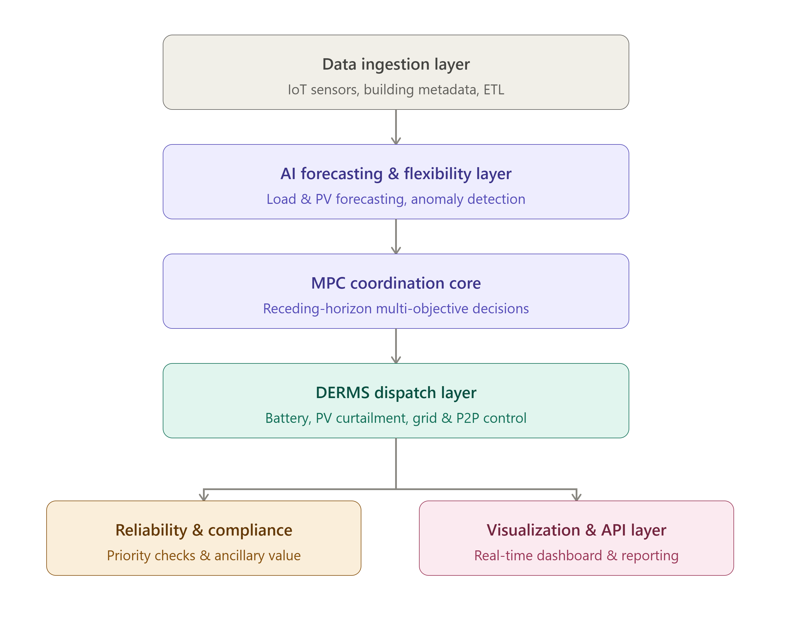
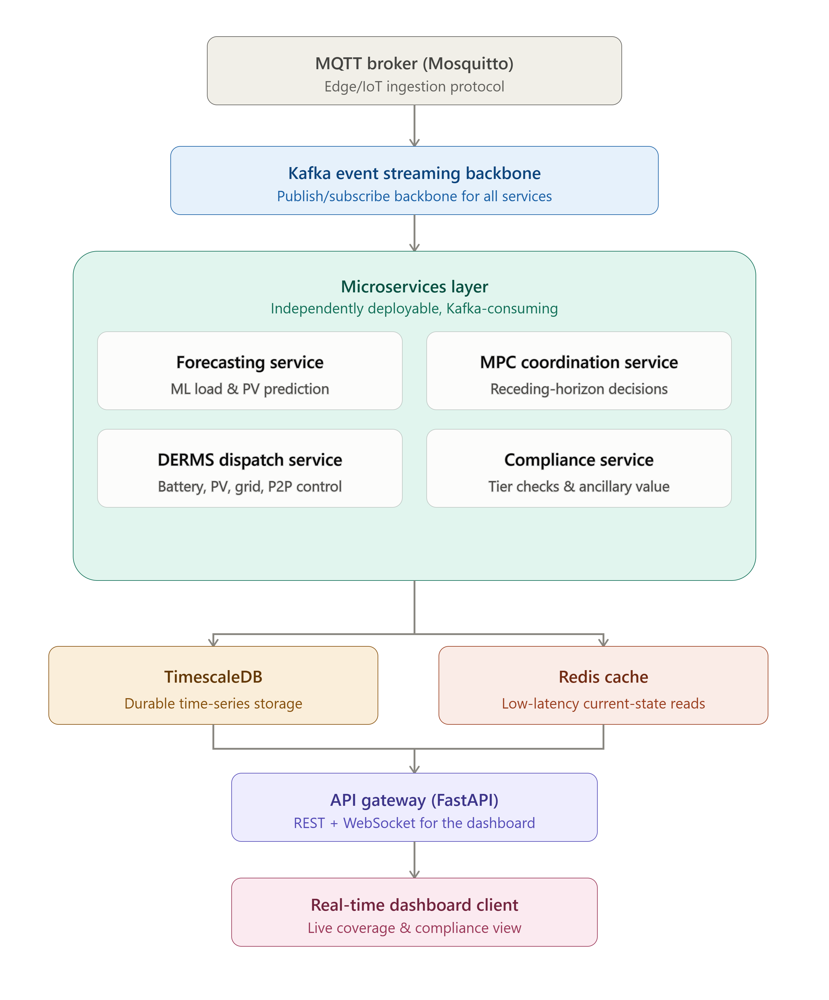

# Smart Supermarket B2G Simulation Engine

A Building-to-Grid (B2G) backend simulation engine for a smart supermarket connected to a local microgrid and, through it, to the macrogrid. The system models how a supermarket consumes grid electricity, produces solar PV, stores energy in a battery, and can trade energy peer-to-peer (P2P) with other participants -- all while continuously guaranteeing reliable electrical coverage of the building and respecting a strict priority/criticality hierarchy on its loads (refrigeration must never lose power, even if lighting is shed first).

---

## Table of Contents

- [Architecture](#architecture)
- [Dataset](#dataset)
- [Version 2 -- Production Upgrade](#version-2----production-upgrade)
- [Target Architecture (Future Work)](#target-architecture-future-work)
- [Tools & Tech Stack](#tools--tech-stack)
- [Setup & Run Instructions](#setup--run-instructions)
- [API Endpoints](#api-endpoints)
- [Output Contract](#output-contract)
- [Project Structure](#project-structure)
- [Papers & Sources Used](#papers--sources-used)
- [Team & Scope](#team--scope)

---

## Architecture



The simulation engine is organized into six clearly separated layers, each implemented as its own Python module under `src/`:

### 1. Data Ingestion Layer (`src/ingestion/`)

Loads the synthetic dataset (`data/dataset.csv`), validates the schema and column types against the expected 30-column specification, handles missing values via forward-fill/back-fill, and exposes a clean per-timestamp dataclass (`TimestepState`) that all downstream layers consume. This layer ensures that any schema drift or data corruption is caught early, before the pipeline begins processing.

### 2. AI Forecasting & Flexibility Layer (`src/forecasting/`)

This layer contains three sub-modules:
- **Forecaster** (`forecaster.py`): Trains a gradient-boosting regressor (scikit-learn) to predict next-step total consumption and PV generation using calendar features (hour, day-of-week), weather context, and lagged values. Predictions are validated against the dataset's own `forecast_consumption` and `forecast_pv` columns.
- **Anomaly Detector** (`anomaly.py`): Uses an Isolation Forest model to produce a normalised anomaly score for each timestep, compared against the dataset's `anomaly_score`. Includes a heuristic source-attribution method that identifies the most deviant feature.
- **Flexibility Estimator** (`flexibility.py`): For each appliance group, computes how much load can be shifted or reduced and for how long. Refrigeration (Tier 1) gets zero flexibility; HVAC (Tier 3) gets a soft budget derived from thermal inertia and current temperature margin; Lighting and Other (Tier 4) can be shed entirely.

### 3. MPC Coordination Core (`src/mpc/`)

A simplified receding-horizon controller inspired by the Taha et al. IEEE framework. At each timestep, the controller looks up to 4 steps ahead (1 hour at 15-min resolution) and selects the combination of actions that minimizes a composite cost: grid import cost (weighted by `energy_price`), a shedding penalty (weighted by criticality tier, with Tier 1 at effectively infinite cost), and a comfort penalty for HVAC soft-shedding. The action set includes: peak shaving (battery discharge during high prices), load shifting (HVAC reduction during demand-response events), valley filling (battery pre-charge ahead of PV dips), and hard shedding (Tier 4, then 3, then 2 -- never Tier 1).

### 4. DERMS Dispatch Layer (`src/derms/`)

Executes the MPC's decision by computing the actual physical `battery_power`, `grid_power`, and `p2p_energy` for each timestep. This layer enforces hard constraints: battery SOC must stay within [10%, 95%], charge/discharge rates are capped at 50 kW, and the energy balance identity is maintained. It translates abstract MPC actions into feasible dispatch commands.

### 5. Reliability & Compliance Layer (`src/compliance/`)

Tags each appliance group with a criticality tier (Tier 1: refrigeration, Tier 2: checkout/IT, Tier 3: HVAC, Tier 4: lighting/other). After a full simulation run, it verifies that Tier 1 was never interrupted (the critical invariant), counts how often each action type fired, and computes a simple ancillary-service value estimate based on avoided peak-demand costs from peak-shaving actions.

### 6. Visualization & API Layer (`src/api/`)

Exposes the per-timestep simulation output as a clean, documented JSON and CSV stream matching the output contract (see below). In v2, this layer also serves a FastAPI application with REST and WebSocket endpoints. It does not implement a frontend -- it produces the data that a separate dashboard (built by another team) will consume.

---

## Dataset

**File:** `data/dataset.csv`

- **Type:** Synthetic, generated for this simulation
- **Resolution:** 15-minute intervals
- **Period:** 1 June -- 30 September 2025 (4 months)
- **Size:** 11,712 rows, 30 columns (~2 MB)

The full 30-column schema, sign conventions, and energy balance identity are documented in [`docs/DATASET.md`](docs/DATASET.md).

---

## Version 2 -- Production Upgrade

### What Changed

Version 2 wraps the existing six-layer pipeline in production infrastructure:

| Component | v1 (CSV-only) | v2 (Production) |
|-----------|---------------|-----------------|
| **API** | Flat JSON/CSV files | FastAPI with REST + WebSocket endpoints |
| **Persistence** | In-memory + CSV dump | TimescaleDB hypertable for durable time-series storage |
| **Cache** | None | Redis for low-latency latest-state reads |
| **Ingestion** | Direct CSV file read | Dual-mode: CSV (tests/determinism) or MQTT (live demo) |
| **Message Broker** | None | Mosquitto MQTT broker for edge telemetry simulation |
| **Deployment** | `python scenario_runner.py` | `docker compose up` (full stack) |
| **CI/CD** | None | GitHub Actions: pytest + ruff lint + Docker build |

### Why

The goal is to earn full production-engineering credit (real API, real DB, real cache, real CI/CD, real message broker) without betting the demo on a distributed system none of us have operated before. The six pipeline modules stay as clearly separated internal packages inside one FastAPI app -- these are exactly the seams a future Kafka-based microservices split would cut along.

### Dual-Mode Ingestion Design

The ingestion layer supports two modes via the `B2G_INGESTION_MODE` environment variable:

- **`csv`** (default): Reads `dataset.csv` directly. This is what the 36+ unit tests and `scenario_runner.py` use, so they stay fast, deterministic, and runnable without Docker.
- **`mqtt`**: Subscribes to the `supermarket/telemetry` MQTT topic on a Mosquitto broker. A companion publisher script (`src/ingestion/mqtt_publisher.py`) replays the dataset row by row, simulating a live edge sensor feed. This is the "live demo" mode used when the full Docker stack is running.

---

## Target Architecture (Future Work)



The diagram above shows the intended production target architecture: MQTT edge ingestion, a Kafka event streaming backbone, four independent microservices (forecasting, MPC, DERMS, compliance), TimescaleDB + Redis, a FastAPI API gateway, and a dashboard client.

**This full Kafka/multi-service split is documented here as the intended next step but is deliberately not implemented for this project's scope.** This is a conscious scoping decision, not a technical limitation. The main reasons:

1. **Operational risk**: No team member has operated a Kafka cluster in production before. Introducing a distributed event streaming platform alongside the energy management logic would add significant operational complexity without proportional benefit at our current scale.
2. **Remaining time**: With a fixed deadline, we prioritised getting the core simulation pipeline correct and well-tested over distributed infrastructure.
3. **Clear upgrade path**: The six internal modules are already cleanly separated along the exact boundaries a Kafka split would use. When the team is ready, each module can be extracted into its own service with Kafka topics replacing the current in-process function calls.

The current v2 architecture (single FastAPI app with real MQTT, TimescaleDB, and Redis) is the pragmatic middle ground that demonstrates all the production-engineering patterns without the operational risk of premature distribution.

---

## Tools & Tech Stack

| Tool | Version | Purpose |
|------|---------|---------|
| Python | 3.13 | Core runtime |
| pandas | >= 2.0 | Data loading, manipulation, and CSV output |
| NumPy | >= 1.24 | Numerical operations |
| scikit-learn | >= 1.3 | Gradient boosting forecaster, Isolation Forest anomaly detector |
| FastAPI | >= 0.110 | REST API and WebSocket endpoints |
| Pydantic | >= 2.0 | Request/response model validation (output contract enforcement) |
| uvicorn | >= 0.27 | ASGI server for FastAPI |
| paho-mqtt | >= 2.0 | MQTT client for dual-mode ingestion |
| Mosquitto | 2.x | MQTT broker (Docker service) |
| SQLAlchemy | >= 2.0 | ORM for TimescaleDB persistence |
| psycopg2 | >= 2.9 | PostgreSQL driver |
| TimescaleDB | latest (PG 16) | Time-series database for durable historical storage |
| Redis | 7.x | Low-latency cache for latest pipeline state |
| Docker / docker-compose | latest | Container orchestration for the full stack |
| GitHub Actions | -- | CI: test, lint (ruff), Docker build on every push/PR |
| pytest | >= 7.4 | Unit and integration testing |
| ruff | >= 0.4 | Fast Python linter |

---

## Setup & Run Instructions

### Option A: Docker (Full Stack -- Recommended)

```bash
# Clone the repository
git clone https://github.com/Eyaiscoding/SmartSupermarket.git
cd SmartSupermarket

# Start all services (Mosquitto, TimescaleDB, Redis, FastAPI backend)
docker compose up --build

# The API is now available at http://localhost:8000
# API docs at http://localhost:8000/docs
```

### Option B: Local Development (No Docker)

```bash
# Clone and set up virtual environment
git clone https://github.com/Eyaiscoding/SmartSupermarket.git
cd SmartSupermarket
python -m venv venv
venv\Scripts\activate        # Windows
# source venv/bin/activate   # macOS/Linux

# Install dependencies
pip install -r requirements.txt

# Run the original scenario runner (CSV mode, no infra needed)
python scenario_runner.py
python scenario_runner.py --scenario all

# Run the FastAPI server (CSV mode, degrades gracefully without DB/Redis)
uvicorn src.api.fastapi_app:app --reload

# Run tests
python -m pytest tests/ -v
```

### Option C: MQTT Live Demo (with Docker stack running)

```bash
# In one terminal: start the full stack
docker compose up

# In another terminal: replay dataset over MQTT
python -m src.ingestion.mqtt_publisher --interval 0.1
```

---

## API Endpoints

| Method | Endpoint | Description |
|--------|----------|-------------|
| GET | `/health` | Health check (reports infrastructure connectivity) |
| GET | `/api/v1/latest` | Latest pipeline state (reads Redis, falls back to TimescaleDB) |
| GET | `/api/v1/history?start=...&end=...` | Historical records by time range (TimescaleDB) |
| POST | `/api/v1/scenario` | Trigger a scenario replay (body: `{"scenario": "none"}`) |
| WS | `/ws/stream` | WebSocket: stream per-timestep output live during a pipeline run |

---

## Output Contract

Each timestep produces one JSON record with the following fields:

```json
{
  "timestamp": "2025-06-01 00:00:00",
  "coverage_ratio": 0.94,
  "coverage_status": "AT_RISK",
  "active_actions": ["hvac_soft_shed"],
  "tier_1_protected": true,
  "battery_soc": 62.3,
  "grid_power": 12.4,
  "p2p_energy": 0,
  "anomaly_flag": false,
  "anomaly_source": null
}
```

| Field | Type | Description |
|-------|------|-------------|
| `timestamp` | string | ISO datetime of this 15-minute interval |
| `coverage_ratio` | float | Ratio of available supply to total consumption (0.0 -- 1.0) |
| `coverage_status` | string | `"NORMAL"` (>= 0.95), `"AT_RISK"` (0.90 -- 0.95), or `"CRITICAL"` (< 0.90) |
| `active_actions` | list[string] | Currently active MPC actions: `"peak_shaving"`, `"hvac_soft_shed"`, `"valley_filling"`, `"hard_shedding"` |
| `tier_1_protected` | bool | Whether Tier 1 loads (refrigeration) were fully supplied this step |
| `battery_soc` | float | Battery state of charge after this step (%) |
| `grid_power` | float | Grid power for this step (kW; positive = import) |
| `p2p_energy` | float | P2P energy exchange for this step (kW) |
| `anomaly_flag` | bool | Whether the anomaly detector flagged this timestep |
| `anomaly_source` | string or null | If anomaly_flag is true, the feature most likely responsible |

The full output is written to both `output/output_<scenario>.json` (array of records) and `output/output_<scenario>.csv` (flat CSV). In v2, the same records are also accessible via the FastAPI REST endpoints and persisted to TimescaleDB for durable historical queries.

---

## Project Structure

```
SmartSupermarket/
|-- .github/
|   |-- workflows/
|       |-- ci.yml                  # GitHub Actions CI workflow
|-- data/
|   |-- dataset.csv                 # Synthetic dataset
|-- docs/
|   |-- DATASET.md                  # Full 30-column schema reference
|-- docker/
|   |-- mosquitto/
|       |-- mosquitto.conf          # Mosquitto broker config
|-- src/
|   |-- __init__.py
|   |-- config.py                   # Centralised settings (env vars)
|   |-- ingestion/                  # Layer 1: Data ingestion
|   |   |-- __init__.py
|   |   |-- loader.py               # CSV loader & validator
|   |   |-- mqtt_publisher.py       # MQTT dataset replay publisher
|   |   |-- mqtt_subscriber.py      # MQTT subscriber (live mode)
|   |-- forecasting/                # Layer 2: AI forecasting & flexibility
|   |   |-- __init__.py
|   |   |-- forecaster.py
|   |   |-- anomaly.py
|   |   |-- flexibility.py
|   |-- mpc/                        # Layer 3: MPC coordination core
|   |   |-- __init__.py
|   |   |-- coordinator.py
|   |-- derms/                      # Layer 4: DERMS dispatch
|   |   |-- __init__.py
|   |   |-- dispatch.py
|   |-- compliance/                 # Layer 5: Reliability & compliance
|   |   |-- __init__.py
|   |   |-- checker.py
|   |-- api/                        # Layer 6: API & output
|   |   |-- __init__.py
|   |   |-- output.py               # v1 JSON/CSV writer
|   |   |-- models.py               # Pydantic models (output contract)
|   |   |-- fastapi_app.py          # FastAPI application
|   |-- persistence/                # Persistence layer (v2)
|       |-- __init__.py
|       |-- timescale.py            # TimescaleDB ORM & hypertable
|       |-- redis_cache.py          # Redis latest-state cache
|-- tests/
|   |-- test_ingestion.py
|   |-- test_forecasting.py
|   |-- test_mpc.py
|   |-- test_derms.py
|   |-- test_compliance.py
|   |-- test_api.py
|   |-- test_fastapi.py             # FastAPI endpoint tests (v2)
|   |-- test_persistence.py         # DB round-trip & Redis tests (v2)
|-- scenario_runner.py              # Original pipeline entry point
|-- Dockerfile                      # Backend container image
|-- docker-compose.yml              # Full stack orchestration
|-- requirements.txt
|-- .gitignore
|-- b2g_general_architecture.png    # Six-layer pipeline diagram
|-- b2g_microservices_architecture.png  # Target architecture diagram
|-- README.md
```

---

## Papers & Sources Used

| # | Paper / Source | Year | Design Decision Justified |
|---|---------------|------|---------------------------|
| 1 | *Building to Grid* -- Guidehouse | 2019 | Overall B2G concept and the building-as-grid-asset framing that motivates the entire pipeline architecture |
| 2 | *Emerging Microgrid Business Models* -- Navigant | 2016 | P2P energy trading model and the microgrid interconnection topology used in the DERMS dispatch layer |
| 3 | *Microgrids -- Critical Facilities* -- Navigant | 2019 | The criticality-tier hierarchy (Tier 1 = never shed) and the reliability-first design constraint |
| 4 | *Buildings-to-Grid Technical Opportunities: From the Grid Perspective* -- DOE/NREL/PNNL | 2014 | The specific grid services modelled (peak shaving, valley filling, demand response) and their value quantification approach |
| 5 | *A Comprehensive Review of Building-to-Grid Interaction* -- Energy Use | 2026 | The six-layer pipeline decomposition and the coverage-ratio metric as the primary reliability indicator |
| 6 | *Buildings-to-Grid Integration Framework* -- IEEE Transactions on Smart Grid (Taha et al.) | 2017 | The simplified receding-horizon MPC formulation and the multi-objective cost function structure (import cost + shedding penalty + comfort penalty) |
| 7 | *Thermal storage capacity in the entire building stock of Denmark for energy flexibility strategies and building-to-grid services* -- REHVA European HVAC Journal | 2024 | The peak shaving / load shifting / valley filling action set, and the HVAC thermal-inertia flexibility budget derived from comfort-band margin |
| 8 | *Data-Driven Analytics for Reliability in the Buildings-to-Grid Integrated System Framework* -- IEEE Access (Bachoumis et al.) | 2023 | The anomaly-detection approach (Isolation Forest) and the data-driven compliance verification methodology |

---

## Team & Scope

This repository covers the **backend simulation engine only**. The dashboard and compliance reporting layers are built separately by other team members and consume this module's output contract (the JSON/CSV files and the REST/WebSocket API described above). The API layer in this repo produces the data; it does not render any frontend UI.
